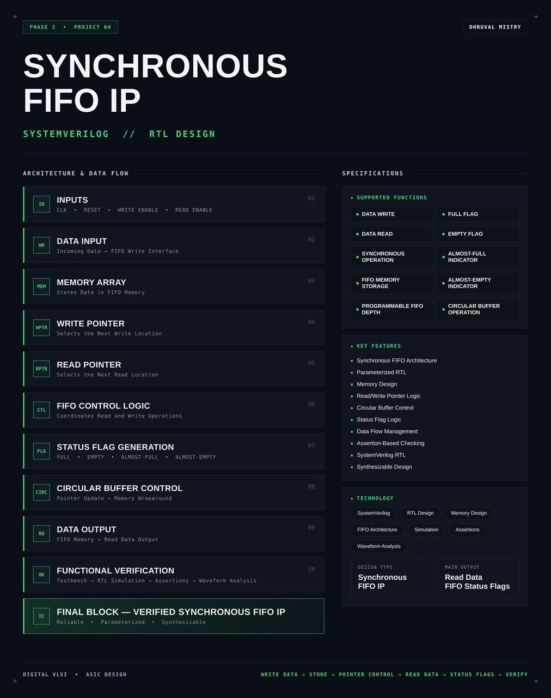
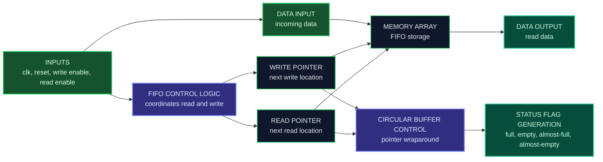
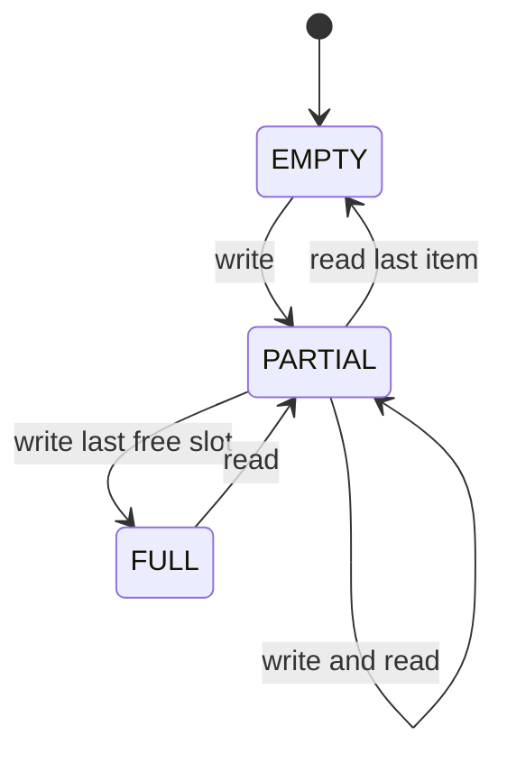
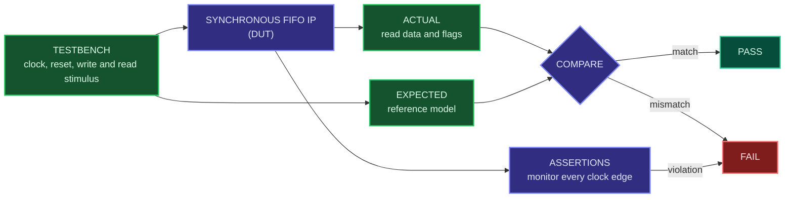

<div align="center">




<b>A synthesizable, parameterized synchronous FIFO with circular buffer control, read and write pointer logic and full, empty, almost-full and almost-empty status flags, written in SystemVerilog.</b>

<br/>


<br/>

[Overview](#overview) |
[At a Glance](#project-at-a-glance) |
[Background](#background-fifo-buffering) |
[Functions](#supported-functions) |
[Architecture](#architecture) |
[Functional Description](#functional-description) |
[Pointer and Flag Logic](#pointer-and-flag-logic) |
[Interface](#interface) |
[Operating Sequence](#operating-sequence) |
[Getting Started](#getting-started) |
[Verification](#verification) |
[Synthesis](#synthesis) |
[Applications](#applications) |
[FAQ](#faq) |
[License](#license)

</div>

---

## Overview

This project implements a **synchronous FIFO (First-In, First-Out) memory IP** in **SystemVerilog**.

A FIFO is a buffer that returns data in the same order it was written. In this design, both the write side and the read side run on **one common clock**. Incoming data is written into a **memory array**. A **write pointer** selects the next location to write and a **read pointer** selects the next location to read. Both pointers walk through the memory and **wrap around** at the end, which turns the array into a **circular buffer**. A **FIFO control logic** block coordinates reads and writes and drives the **status flags**: full, empty, almost-full and almost-empty.

The FIFO is **parameterized**, so the data width and the depth can be changed without touching the logic. The design is **sequential**, written in a **synthesis-friendly** style, checked with a testbench, **assertions** and waveform analysis, and packaged as a reusable FIFO IP block.

<table>
<tr>
<td width="50%" valign="top">

#### Objectives
- Design a reusable synchronous FIFO in SystemVerilog
- Store data in a memory array with write and read pointers
- Reuse memory locations with circular buffer wraparound
- Generate full, empty, almost-full and almost-empty flags
- Make data width and depth configurable
- Protect the design with assertion-based checking
- Verify ordering, flags and corner cases through simulation

</td>
<td width="50%" valign="top">

#### Key Features
- Synchronous FIFO architecture
- Parameterized RTL
- Memory design
- Read and write pointer logic
- Circular buffer control
- Status flag logic
- Data flow management
- Assertion-based checking
- SystemVerilog RTL
- Synthesizable design

</td>
</tr>
</table>

---

## Project at a Glance

| Attribute | Detail |
|:--|:--|
| **Design type** | Synchronous FIFO IP |
| **Description language** | SystemVerilog (RTL) |
| **Logic style** | Sequential, single clock domain |
| **Storage** | Memory array organized as a circular buffer |
| **Addressing** | Separate write pointer and read pointer |
| **Configurability** | Parameterized data width and FIFO depth |
| **Status flags** | Full, empty, almost-full, almost-empty |
| **Main output** | Read data, FIFO status flags |
| **Checking** | Testbench, assertions, waveform analysis |
| **Functions** | 10 (write, read, storage, flags, depth control, circular operation) |
| **Simulation** | Verilator |
| **Waveform analysis** | GTKWave |
| **Synthesis** | Yosys |
| **License** | MIT |

---

## Background: FIFO Buffering

Digital blocks rarely produce and consume data at exactly the same moment. A producer may send a burst of data while the consumer is busy, or the consumer may be ready while no data has arrived yet. A **FIFO** sits between them and absorbs the difference. The first item written is the first item read, so the order of the data is always preserved.

A FIFO is called **synchronous** when the write port and the read port share the same clock. That keeps the design simple, because the two pointers and the status flags can all be compared directly without any clock-domain crossing logic. A FIFO whose two ports use different clocks is called asynchronous and needs extra synchronization.

Inside, the FIFO is a small memory plus two counters, called pointers. Writing stores data at the write pointer and advances it. Reading returns data from the read pointer and advances it. When a pointer reaches the last location it returns to the first one, which is called **wraparound**. This reuse of memory is what makes the buffer circular, and it lets a small memory handle an endless stream of data.

Because the FIFO has limited space, it has to tell the outside world how full it is. The **full flag** tells the writer to stop, the **empty flag** tells the reader that there is nothing to read, and the **almost-full** and **almost-empty** indicators give an early warning before those limits are reached.

---

## Supported Functions

| Group | Function | Description |
|:--|:--|:--|
| **Data path** | `DATA WRITE` | Stores incoming data in the FIFO when write is enabled |
| **Data path** | `DATA READ` | Returns the oldest stored data when read is enabled |
| **Timing** | `SYNCHRONOUS OPERATION` | Write and read logic share one clock |
| **Storage** | `FIFO MEMORY STORAGE` | Memory array that holds the buffered data |
| **Configuration** | `PROGRAMMABLE FIFO DEPTH` | Depth is set through a parameter |
| **Control** | `CIRCULAR BUFFER OPERATION` | Pointers wrap around so memory locations are reused |
| **Status** | `FULL FLAG` | Indicates that no more data can be written |
| **Status** | `EMPTY FLAG` | Indicates that no data is available to read |
| **Status** | `ALMOST-FULL INDICATOR` | Early warning that the FIFO is close to full |
| **Status** | `ALMOST-EMPTY INDICATOR` | Early warning that the FIFO is close to empty |

---

## Architecture

The design is organized as an input stage (clock, reset, write enable, read enable and write data), a memory array, a write pointer and a read pointer, a FIFO control logic block with status flag generation, and a data output stage.

#### Block diagram

```text
                        +------------------------------------------------------+
                        |                  SYNCHRONOUS FIFO IP                 |
                        |                                                      |
  WRITE DATA ---------->|---------------+                                      |
                        |               v                                      |
                        |        +---------------+                             |
  WRITE ENABLE -------->|--+     |               |                             |
                        |  |     |  MEMORY ARRAY |------------------------------> READ DATA
                        |  |     |  (FIFO STORE) |                             |
                        |  |     +-------^-------+                             |
                        |  |             | write addr      | read addr         |
                        |  |      +------+------+   +------+------+            |
                        |  +----->| WRITE       |   | READ        |<-----+     |
                        |         | POINTER     |   | POINTER     |      |     |
                        |         +------+------+   +------+------+      |     |
                        |                |                 |             |     |
                        |                v                 v             |     |
                        |        +-------------------------------+       |     |
  CLK ----------------->|------->|        FIFO CONTROL LOGIC     |       |     |
  RESET --------------->|------->|  coordinates read and write   |       |     |
                        |        +---------------+---------------+       |     |
                        |                        |                       |     |
                        |                        v                       |     |
                        |        +-------------------------------+       |     |
                        |        |     STATUS FLAG GENERATION    |-----------------> FULL
                        |        |  full | empty | almost-full   |       |     |   > EMPTY
                        |        |       |       | almost-empty  |-----------------> ALMOST-FULL
                        |        +-------------------------------+       |     |   > ALMOST-EMPTY
  READ ENABLE --------->|------------------------------------------------+     |
                        +------------------------------------------------------+
```

#### Data flow



#### Block breakdown

| # | Block | Role |
|:-:|:--|:--|
| `01` | **Inputs** | Clock, reset, write enable and read enable |
| `02` | **Data Input** | Incoming data presented to the FIFO write interface |
| `03` | **Memory Array** | Stores data in FIFO memory |
| `04` | **Write Pointer** | Selects the next write location |
| `05` | **Read Pointer** | Selects the next read location |
| `06` | **FIFO Control Logic** | Coordinates read and write operations |
| `07` | **Status Flag Generation** | Full, empty, almost-full and almost-empty |
| `08` | **Circular Buffer Control** | Updates the pointers and wraps them back to the start of the memory |
| `09` | **Data Output** | Delivers data from FIFO memory as read data |
| `10` | **Functional Verification** | Testbench, RTL simulation, assertions and waveform analysis |

> **Final design block:** `WRITE DATA -> STORE -> POINTER CONTROL -> READ DATA -> STATUS FLAGS`

---

## Functional Description

#### Inputs
The FIFO takes a clock, a reset, a write enable and a read enable. The write data is presented on the write interface. All logic is clocked by the same clock, so write and read events are processed in the same clock domain.

#### Data input
When write enable is active and the FIFO is not full, the incoming data is accepted at the next clock edge and stored in the memory array.

#### Memory array
A memory with as many locations as the configured depth. Each location holds one data word. Data is written at the write pointer location and read from the read pointer location.

#### Write pointer
Holds the address of the next location to be written. It advances by one after each accepted write.

#### Read pointer
Holds the address of the next location to be read. It advances by one after each accepted read.

#### FIFO control logic
Decides whether a write or a read request is accepted. A write is accepted only if the FIFO is not full, and a read is accepted only if the FIFO is not empty. It also handles the case where a write and a read arrive in the same clock cycle.

#### Circular buffer control
When a pointer is about to move past the last memory location it wraps back to the first one. Memory locations are therefore reused continuously, and the FIFO can pass any amount of data through a fixed-size memory.



| Occupancy state | Meaning |
|:--|:--|
| `EMPTY` | No data stored. Reads are not accepted |
| `PARTIAL` | Some data stored. Reads and writes are both accepted. The almost-empty and almost-full indicators can be active here |
| `FULL` | Every location is used. Writes are not accepted |

#### Status flag generation
Produces the full, empty, almost-full and almost-empty flags from the pointer state. See [Pointer and Flag Logic](#pointer-and-flag-logic).

#### Data output
Returns the data stored at the read pointer location as read data. Because the FIFO is first-in, first-out, the data returned is always the oldest item not yet read.

---

## Pointer and Flag Logic

#### Write, read and wraparound

```text
 depth = 8 (locations 0 to 7)

  write pointer -> next free location      read pointer -> oldest stored item

        0    1    2    3    4    5    6    7
      +----+----+----+----+----+----+----+----+
      | D4 | D5 |    |    |    | D1 | D2 | D3 |
      +----+----+----+----+----+----+----+----+
                 ^                   ^
                 | write pointer     | read pointer
                 
  The write pointer passed location 7 and wrapped back to 0.
  Occupied: locations 5, 6, 7, 0, 1  (5 items)
```

The pointers always count forward and wrap at the end of the memory. The number of stored items is the distance from the read pointer to the write pointer, counted in the direction of travel.

#### Telling full from empty

When the read pointer and the write pointer point to the same location, the FIFO is either completely empty or completely full. A common way to tell them apart is to make each pointer one bit wider than the address needs. The extra bit toggles every time the pointer wraps. Another common way is to keep a separate item counter. The method used by this IP is defined in the RTL sources.

| Condition | Meaning |
|:--|:--|
| Pointers equal, extra bits equal | FIFO is empty |
| Pointers equal, extra bits different | FIFO is full |

#### Status flags (illustrative, depth 8)

| Flag | Raised when | Example |
|:--|:--|:--|
| Empty | Stored items equal 0 | 0 of 8 stored |
| Full | Stored items equal depth | 8 of 8 stored |
| Almost-empty | Stored items are at or below the almost-empty threshold | 1 of 8 stored with a threshold of 1 |
| Almost-full | Stored items are at or above the almost-full threshold | 7 of 8 stored with a threshold of 7 |

The almost-empty and almost-full thresholds give the surrounding logic time to react before the FIFO is completely empty or completely full. The threshold values used by this IP are listed in the configuration table.

#### Behavior at the limits

| Situation | Expected behavior |
|:--|:--|
| Write while full | The write is not accepted and stored data is not overwritten |
| Read while empty | The read is not accepted and no valid data is returned |
| Write and read in the same cycle | Both are handled and the number of stored items stays the same |
| Reset | Pointers return to the start, the FIFO is empty and the empty flag is raised |

---

## Interface

#### Ports

| Port | Direction | Description |
|:--|:-:|:--|
| Clock | Input | Common clock for the write and read logic |
| Reset | Input | Resets the pointers and flags to their initial state |
| Write enable | Input | Requests a write of the data on the write data port |
| Write data | Input | Data to be stored |
| Read enable | Input | Requests a read of the oldest stored data |
| Read data | Output | Data read from the FIFO |
| Full | Output | FIFO cannot accept more data |
| Empty | Output | FIFO has no data to read |
| Almost full | Output | FIFO is close to full |
| Almost empty | Output | FIFO is close to empty |

Exact port names, widths and reset polarity are defined in the RTL sources under `rtl/`.

#### Parameters and configuration

| Item | Value |
|:--|:-:|
| Data width | `TBD` |
| FIFO depth | `TBD` |
| Almost-full threshold | `TBD` |
| Almost-empty threshold | `TBD` |
| Reset polarity | `TBD` |
| Read data timing (registered or combinational) | `TBD` |

---

## Operating Sequence

The FIFO follows the same path every time: write data, store it, move the pointers, read data, update the flags, then verify.


1. **Reset.** The pointers go to the start and the FIFO reports empty.
2. **Write.** The producer raises write enable with data. The data is stored at the write pointer and the write pointer advances.
3. **Flag update.** The empty flag clears. As the FIFO fills, the almost-full and then the full flag are raised.
4. **Read.** The consumer raises read enable. The oldest item is returned from the read pointer location and the read pointer advances.
5. **Wraparound.** When a pointer reaches the last location it returns to location zero.
6. **Flag update.** As the FIFO drains, the full flag clears, then the almost-empty and finally the empty flag are raised.

---

## Repository Structure

```text
synchronous-fifo-ip/
├── rtl/
│   └── sync_fifo.sv            # Parameterized synchronous FIFO
├── tb/
│   └── sync_fifo_tb.sv         # Self-checking testbench with assertions
├── sim/
│   └── waves.vcd               # Generated waveform dump
├── synth/
│   ├── synth.ys                # Yosys synthesis script
│   ├── fifo_netlist.v          # Gate-level netlist
│   └── synth_report.txt        # Yosys stat report
├── LICENSE
└── README.md
```

---

## Technology Stack

| Tool | Role in this project |
|:--|:--|
|  | RTL design, testbench and assertions |
|  | Compiles and simulates the design |
|  | Views the simulation waveforms |
|  | Synthesizes the RTL to a gate-level netlist |

---

## Getting Started

#### Prerequisites

| Tool | Purpose | Version |
|:--|:--|:--|
| Verilator | RTL simulation | 5.x or later |
| GTKWave | Waveform viewer | Any recent |
| Yosys | RTL synthesis | Any recent |

```bash
# Ubuntu / Debian
sudo apt update
sudo apt install verilator gtkwave yosys
```

#### 1. Clone

```bash
git clone https://github.com/dhruvalmistry2007/synchronous-fifo-ip.git
cd synchronous-fifo-ip
```

#### 2. Simulate

```bash
verilator --binary --trace --assert -Wall --top-module sync_fifo_tb \
  rtl/sync_fifo.sv tb/sync_fifo_tb.sv
./obj_dir/Vsync_fifo_tb
```

#### 3. View waveforms

```bash
gtkwave sim/waves.vcd
```

#### 4. Synthesize

```bash
yosys -p "read_verilog -sv rtl/sync_fifo.sv; synth -top sync_fifo; stat; write_verilog synth/fifo_netlist.v"
```

---

## Verification

The testbench writes and reads data in many patterns, drives the FIFO to its limits and checks the data order, the status flags and the pointer behavior. Assertions watch the design on every clock edge, and the results are inspected as waveforms.



A software-style reference queue in the testbench receives the same writes as the FIFO. Every item read from the FIFO is compared with the item at the head of that queue, which checks the first-in, first-out order and the data values at the same time.

#### Test plan

| Area | Scenario | Expected behavior |
|:--|:--|:--|
| Reset | Apply reset | Pointers return to the start, empty is raised and full is cleared |
| Single write and read | Write one word, then read it | The same word is returned and the FIFO becomes empty again |
| Order | Write a sequence, then read it all | Data comes out in the order it was written |
| Fill to full | Write until the FIFO is full | Full is raised after the last free location is used |
| Write when full | Attempt a write while full | The write is not accepted and stored data is unchanged |
| Drain to empty | Read until the FIFO is empty | Empty is raised after the last item is read |
| Read when empty | Attempt a read while empty | The read is not accepted and the empty flag stays raised |
| Almost-full | Fill past the threshold | Almost-full is raised at the configured level |
| Almost-empty | Drain below the threshold | Almost-empty is raised at the configured level |
| Wraparound | Write and read more words than the depth | Both pointers wrap and the data stays correct |
| Simultaneous access | Write and read in the same cycle | Both are handled and the number of stored items is correct |
| Continuous streaming | Alternate writes and reads over a long run | No data is lost, duplicated or reordered |
| Depth and width | Re-run with other parameter values | Behavior stays correct for each configuration |
| Random traffic | Random write and read enables | Reference queue and FIFO output always match |

#### Assertions

| Property | What it checks |
|:--|:--|
| No overflow | A write is never accepted while the FIFO is full |
| No underflow | A read is never accepted while the FIFO is empty |
| Flag exclusivity | Full and empty are never raised at the same time |
| Flag consistency | Flags always agree with the number of stored items |
| Pointer range | Pointers never point outside the memory array |
| Reset state | After reset the FIFO is empty and not full |

#### Coverage matrix

| Area | Functions checked | Result |
|:--|:--|:-:|
| Data path | Data write, data read | `TBD` |
| Storage | FIFO memory storage, circular buffer operation | `TBD` |
| Configuration | Programmable FIFO depth | `TBD` |
| Status | Full, empty, almost-full, almost-empty | `TBD` |
| Timing | Synchronous operation | `TBD` |
| Checking | Assertion-based checking | `TBD` |

#### Waveform analysis checklist

| Signal | What to confirm |
|:--|:--|
| Clock and reset | Reset puts the FIFO in its initial empty state |
| Write enable and write data | Data is accepted only when the FIFO is not full |
| Write pointer | Advances once per accepted write and wraps at the end |
| Read enable and read data | Data is returned in write order |
| Read pointer | Advances once per accepted read and wraps at the end |
| Full and empty | Switch exactly at the boundary conditions |
| Almost flags | Switch at the configured thresholds |
| Simultaneous access | Occupancy stays the same when a write and a read happen together |

---

## Synthesis

The RTL is synthesized with **Yosys** to confirm that the design is synthesizable. The flow reads the SystemVerilog source, elaborates the design, maps it to generic logic cells, prints a cell statistics report and writes the gate-level netlist. The netlist and the report are stored in [`synth/`](synth/).


| Step | Command | Purpose |
|:--|:--|:--|
| Read | `read_verilog -sv` | Loads the SystemVerilog RTL |
| Synthesize | `synth -top sync_fifo` | Elaborates and maps the design to generic gates |
| Report | `stat` | Prints cell and wire statistics |
| Export | `write_verilog` | Writes the gate-level netlist |

#### Results

| Metric | Value |
|:--|:-:|
| Top module | `sync_fifo` |
| Total cells | `TBD` |
| Flip-flops | `TBD` |
| Memory bits | `TBD` |
| Wires / wire bits | `TBD` |
| Logic depth / critical path | `TBD` |
| Area | `TBD` |

---

## Design Considerations

| Aspect | Approach |
|:--|:--|
| **Logic style** | Sequential design with one clock for the write and read sides |
| **Storage** | Memory array indexed by the write and read pointers |
| **Buffer type** | Circular buffer, so memory locations are reused |
| **Full and empty detection** | Pointer comparison or an occupancy count, defined in the RTL |
| **Configurability** | Data width, depth and flag thresholds set through parameters |
| **Safety** | Overflow and underflow protection, backed by assertions |
| **Synthesis** | Synthesizable RTL structure, targeting a Yosys flow |
| **Verification** | Simulation with a reference queue, assertions and waveform inspection |

#### Current limitations
- Single clock domain only, with no asynchronous (dual-clock) operation
- Simulation-based verification only, with no formal verification
- No error output flags for overflow or underflow attempts
- Depth and data width are fixed when the design is built, not at run time

---

## Applications

- Rate matching between a fast producer and a slower consumer
- Buffering between processing stages in a data path
- Packet and stream buffering in communication blocks
- Buffering the data of UART, SPI and other serial peripherals
- Temporary storage in video, audio and sensor pipelines
- Queue building block in ASIC and FPGA designs
- Teaching and reference design for memory-based digital design

---

## Customization

#### Change the data width or depth

Set the data width and depth parameters of the FIFO when it is instantiated. The pointer width follows from the depth, so no other change to the logic is needed.

```systemverilog
sync_fifo #(
    .DATA_WIDTH (8),
    .DEPTH      (16)
) u_fifo (
    // connect clock, reset, write and read ports and status flags
);
```

The parameter names above are illustrative. The actual names are listed in the configuration table and in `rtl/sync_fifo.sv`.

#### Change the almost-full and almost-empty thresholds

1. Set the threshold parameters to the number of items at which the early warning should appear.
2. Keep both thresholds between zero and the FIFO depth.
3. Update the configuration table in this README.
4. Add test cases at the new threshold values and re-run the simulation.

---

## Troubleshooting

| Problem | Likely cause | Fix |
|:--|:--|:--|
| `--binary` option not recognized | Verilator version is older than 5.x | Upgrade Verilator to 5.x or later |
| `waves.vcd` is not generated | Tracing is not enabled | Build with `--trace` and make sure the testbench calls `$dumpfile` and `$dumpvars` |
| Assertions do not fire | Assertions are not enabled in the simulator | Build with `--assert` |
| Data comes out in the wrong order | Pointers are not reset or not wrapping | Check the reset and the wraparound condition |
| Full and empty raised together | Pointer comparison does not separate the two cases | Use the extra pointer bit or an occupancy count |
| Last item is lost at wraparound | Wraparound happens at the wrong location | Check the pointer wrap against the configured depth |
| Wrong read data right after a read | Read data timing differs from what the testbench expects | Check whether read data is registered or combinational |
| Yosys cannot find the top module | `-top` name does not match the module name | Use the exact module name from `rtl/sync_fifo.sv` |

---

## FAQ

**Why is it called synchronous?**
The write side and the read side use the same clock. That keeps the pointer and flag logic simple, since no clock-domain crossing is needed.

**Why a circular buffer?**
A circular buffer reuses the same memory locations over and over by wrapping the pointers. A small memory can therefore carry an unlimited stream of data.

**How does the FIFO tell full from empty if the pointers are equal in both cases?**
It adds information beyond the address. Common methods are an extra wrap bit on each pointer or a separate occupancy counter.

**Why are there almost-full and almost-empty flags?**
They warn the surrounding logic early. A producer can slow down before the FIFO overflows, and a consumer can prepare before the FIFO runs dry.

**What happens if I write to a full FIFO or read from an empty one?**
The request is not accepted, so stored data is never overwritten and invalid data is never delivered. Assertions in the testbench check this.

**Why use assertions?**
Assertions check the design rules on every clock edge, so a violation is reported at the moment it happens instead of showing up later as a wrong output.

**Why Verilator, GTKWave and Yosys?**
They are free, open-source tools that cover simulation, waveform viewing and synthesis, so the whole project can be reproduced without licenses.

---

## Learning Outcomes

- Designing a memory-based block with read and write pointers
- Implementing circular buffer control with pointer wraparound
- Generating full, empty and threshold status flags
- Writing parameterized, reusable RTL
- Handling simultaneous read and write access
- Writing assertions and a reference-model testbench
- Debugging with waveform analysis and running RTL synthesis

---

## Design Flow


<div align="center">

`WRITE DATA` | `STORE` | `POINTER CONTROL` | `READ DATA` | `STATUS FLAGS` | `VERIFY`

</div>

---

## Future Work

- Add an asynchronous (dual-clock) FIFO with Gray-coded pointers
- Add overflow and underflow error output flags
- Add a data count output that reports the number of stored items
- Add first-word-fall-through (show-ahead) read mode
- Add a standard stream interface such as AXI-Stream
- Add formal properties for pointer and flag correctness
- Add self-checking randomized tests with functional coverage
- Run the design through an RTL-to-GDSII flow (OpenLane)

---

## Contributing

Suggestions and improvements are welcome. Open an issue to discuss a change, or submit a pull request with a clear description of what it does and the simulation results that support it.

---

## References

- [Verilator](https://www.veripool.org/verilator/): open-source SystemVerilog simulator
- [GTKWave](https://gtkwave.sourceforge.net/): waveform viewer
- [Yosys Open SYnthesis Suite](https://yosyshq.net/yosys/): open-source RTL synthesis framework
- IEEE Std 1800: SystemVerilog language standard

---

## License

This project is licensed under the **MIT License**. See the [LICENSE](LICENSE) file for details.

---

## Author

<div align="center">

**Dhruval Mistry**

[](https://github.com/dhruvalmistry2007)

<br/>


</div>
